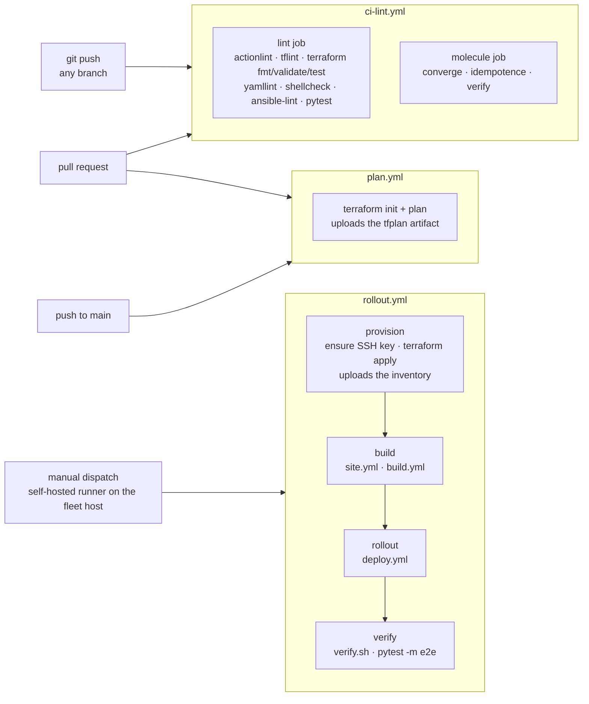
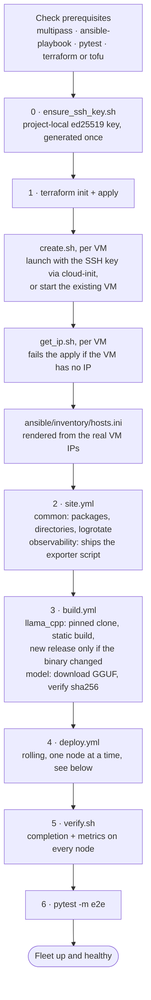
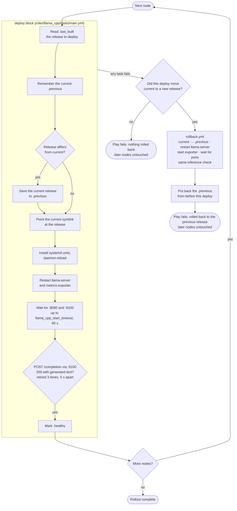
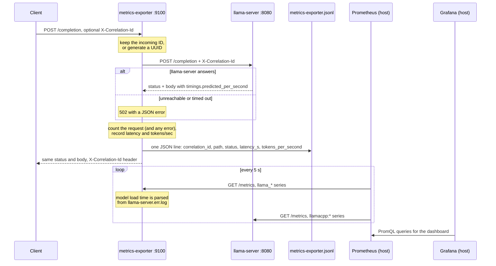

# Architecture

## Component relationships

```
Developer
  │  git push / PR, `make deploy`, manual rollout dispatch, `make act-*` (act)
  ▼
GitHub Actions (.github/workflows) ── each workflow has its own trigger; all runnable locally via `act`
  ├─ ci-lint.yml  (push, PR)          → lint job: actionlint, tflint, terraform fmt/validate/test,
  │                                     yamllint, shellcheck, ansible-lint, pytest; molecule job
  ├─ plan.yml     (PR, push to main)  → terraform plan (never applies)
  └─ rollout.yml  (manual dispatch)   → provision → build → rollout → verify, on a self-hosted
                                        runner on the fleet host
scripts/deploy.sh (`make deploy`) ─── runs the same stages directly on the host
        │
        ▼
Terraform (terraform/) ── VM lifecycle via modules/vm (Multipass; Lima/Vagrant branches unverified)
        │  writes ansible/inventory/hosts.ini from real VM IPs (local_file + templatefile)
        ▼
Ansible (ansible/, driven by ansible.cfg at repo root), over SSH with the fleet key
  ├─ playbooks/site.yml    → common + observability roles on all nodes
  ├─ playbooks/build.yml   → llama_cpp (build) + model roles
  ├─ playbooks/deploy.yml  → llama_cpp (deploy), serial:1, health-gated, auto-rollback on failure
  └─ playbooks/rollback.yml→ llama_cpp (rollback) for a single targeted node
        │
        ▼
Fleet nodes (llama-node-1..3, Multipass VMs)
  ├─ metrics-exporter.service :9100 — proxies POSTs to llama-server; /metrics; JSON access
  │                                   log with correlation IDs
  ├─ llama-server.service     :8080 — runs the `current` release; native /metrics and /health
  └─ /opt/llama-fleet/releases/{timestamp}/  — immutable releases, `current` symlink, `.previous` pointer
        │
        │  scraped every 5 s (:9100 and :8080); targets rendered from the inventory
        ▼
Observability on the host (Docker Compose, `make observability`): Prometheus → Grafana dashboard
```

## Workflows

The diagrams below are Mermaid; GitHub and most Markdown previewers render them.

### CI/CD pipelines

The three workflows are independent: nothing chains lint into plan into rollout.



Under `act` (`make act-plan`, `make act-rollout`) the jobs run in Docker containers that
can't reach the hypervisor, so `rollout.yml` swaps each fleet-touching step for a static
check: provision runs `terraform validate` + `plan`, build and rollout run
`ansible-playbook --syntax-check`, and verify runs the real `verify.sh` and e2e tests only
if `act-rollout.sh` found a live fleet to pass in (otherwise `bash -n` on the scripts).

### `make deploy`

`scripts/deploy.sh` runs the real pipeline on the host. It uses `set -e`, so the first
failing step stops it.



### Rolling deploy and rollback

`deploy.yml` runs this for one node at a time (`serial: 1`). With `max_fail_percentage: 0`,
a failure on any node stops the rollout before the next node is touched, so the rest of
the fleet keeps serving the release it already had.



If the rollback itself fails, the rescue stops there and the play fails with that error:
either the restored release fails its inference check, or it's the node's first deploy
and there's no previous release ("No previous release recorded"). Either way the node
needs looking at by hand (`docs/troubleshooting.md`).
`scripts/rollback.sh <node>` runs the same `rollback.yml` on its own.

### Requests, metrics and logs

Every inference request, whether from a user, the deploy gate, `health_check.sh` or the e2e
tests, goes through the exporter on `:9100`, which is what makes its metrics and access
log reflect real traffic.



llama-server doesn't log the correlation ID; see "Logging and correlation IDs" in the
README for this and the other logging gaps.

## For Production ready

To productionize: replace `backend "local"` in `terraform/providers.tf` with `backend "s3"` (+ DynamoDB lock table) or `backend "gcs"`, and move `.secrets`/vault content into a real
secrets manager (AWS Secrets Manager, Vault, etc.).

## Why VM lifecycle is `null_resource` + CLI wrapper, not a native provider

There is no first-party, well-maintained Terraform provider for Multipass or Lima. Rather
than hand-roll one, `terraform/modules/vm` wraps the CLI (`multipass`/`limactl`/`vagrant`)
behind `local-exec` provisioners and an `external` data source for IP discovery. This keeps
the *interface* Terraform-shaped (resources, outputs, `terraform plan/apply/destroy`) while staying swappable — `var.backend_engine` picks the implementation.

## `ansible.cfg` lives at the repo root

`roles_path` and `inventory` in `ansible.cfg` are resolved relative to wherever the config
file itself sits, not relative to the current shell directory. Every script, Makefile
target, and CI step in this repo invokes `ansible-playbook`/`ansible-lint` from the repo
root, so `ansible.cfg` sits there too (not inside `ansible/`) — otherwise role lookups
(`common`, `llama_cpp`, `model`, `observability`) silently fail with "role not found"
whenever a command isn't run from inside the `ansible/` subdirectory.

## Fleet SSH access

Multipass does not expose a key usable by plain `ssh` (and therefore Ansible) by default —
it manages its own internal keypair purely for `multipass shell`/`exec`. `scripts/ensure_ssh_key.sh`
generates a project-local ed25519 keypair once (idempotent, gitignored — never committed).
`terraform/modules/vm/scripts/create.sh` injects the public half into each new VM via
cloud-init's top-level `ssh_authorized_keys` key, which Multipass's own docs confirm merges
safely with its default-user setup rather than replacing it. The generated Ansible inventory
points `ansible_ssh_private_key_file` at the private half. Because cloud-init only runs at
first boot, this only takes effect on newly created VMs — see `docs/troubleshooting.md` if
you have pre-existing VMs from before this was added.

## Rolling update & rollback design

- Each release is staged under `releases/<timestamp>/`, never overwritten in place, and is a
  statically linked `llama-server` (`-DBUILD_SHARED_LIBS=OFF`). A shared build would leave
  every release loading `libllama`/`libggml` from the build dir, which each build
  overwrites, so rolling back would not restore the old code.
- `current` is a symlink; cutover is an atomic `ln -sfn`.
- `.previous` records the prior release's real path before cutover, enabling `rollback.yml`
  to restore it without needing a second build. It is only rewritten when a deploy switches
  to a different release, so re-deploying the current release keeps the rollback target, and
  a failed deploy only rolls back if it actually moved `current`. After such a rollback the
  pointer is reset to what it was before the deploy, so the next rollback still goes one
  release back.
- `ansible/playbooks/deploy.yml` uses `serial: 1` with `max_fail_percentage: 0`: Ansible
  processes one host at a time and stops the whole play if any host's block fails —
  combined with the `rescue:` block in `roles/llama_cpp/tasks/main.yml`, a failed health
  check on node N automatically rolls back node N and halts before touching node N+1..3.
  The rest of the fleet is left serving the previous, known-good release throughout.

## Observability design

`scripts/metrics_exporter.py` runs as a systemd-managed sidecar per node (stdlib only).
It proxies POSTs such as `/completion` to the local `llama-server`, and for each request
records latency (p50/p95), generation throughput from llama-server's own
`timings.predicted_per_second`, and success/failure, and writes one JSON line with a
`correlation_id` (propagated from, and returned as, `X-Correlation-Id`) to
`/var/log/llama-fleet/metrics-exporter.jsonl`. Model load time is parsed from
llama-server's log. The deploy health gate and `verify.sh` go through this proxy, so a
passing rollout proves the sidecar works and the metrics reflect real traffic.

Prometheus uses `file_sd` targets rendered from the Ansible inventory
(`scripts/gen_prom_targets.sh`), so it follows whatever fleet Terraform provisioned, and
scrapes both the sidecar (`:9100`) and llama-server's native `--metrics` (`:8080`).
Grafana gets the datasource and dashboard through provisioning
(`observability/grafana/provisioning/`); `make observability` starts both.


## Security

- Node secrets, if any are added, go in `ansible/inventory/group_vars/llama_fleet/vault.yml`
  (gitignored, encrypted with `ansible-vault` — see `vault.yml.example`). None are needed today.
- No secrets in Terraform state (local-only, gitignored).
- `act` secrets passed via `--secret-file .secrets` (gitignored), not committed workflow env.
- SSH host key checking disabled only for the throwaway local fleet (`ansible.cfg`), which is appropriate for ephemeral local VMs but called out explicitly as a dev-only shortcut.
